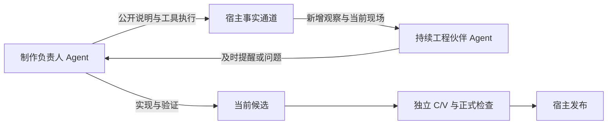

# 软件工程基线

当前整改针对 software-v1 的生成、迭代与交付链路。业务可运行不代表工程合格；既有验收证据保留其原版本与范围。

2026-11-09接手任务见[工程执行与验收职责收敛交接](../05_PROJECT_PLAN/session-handoff-engineering-repair-20261109.md)：校园客户端实测暴露运行时发现/项目绑定、测试修正完整性、实例身份、诊断读取和伙伴调度的组合问题。下一会话按其中批次推进离线工程；完整方案尚未实施，付费试验仍按用户要求暂停。下文记录既有机制及局部修复，不能作为新方案完成或校园产物交付证明。

## 三项整改的架构审计与当前实现

2026-11-07 实测后的重点是方案与验证一致、失败归因与实验选择、变更与交付一致。现有工具执行、版本绑定、实验工作区和委派可以复用；不能再以默认技能文本代替真实工程管理。

- 改造前的缺口：working-state 未投影已确认交付方式和外层时间/金额余量；普通研究协作共用产品目录，独立实验目录不等于持续工程搭档；Pi 与传输对环境思考档位的解释不一致，试验入口只允许 off/low。
- 先收敛事实和执行配置：同一处解析思考档位，实际请求记录有效 effort；把已确认交付、验证方式及可读资源余量交给 Agent，不从这些事实派生新的机械审批。
- 工程搭档采用独立工作记录与版本化输入副本，复用现有委派、取消、预算和交接。意见由负责人判断并整合，不直接写产品、不代签 C/V、不改用户目标或冻结断言。工作区隔离不宣称操作系统沙箱。
- 搭档属于可比较的协作方案：避免无变化轮询，持续跟踪公开制作过程、实际失败证据和当前决策；不强制每次修改都审阅，不默认新角色必然优于单负责人。
- 验证顺序：离线证明工作区/身份/预算/配置正确，再用相同任务与总额度比较单负责人、较高思考强度和双角色。一次 low 档试验不足以认定模型上限；供应商短暂 500 单独记为外部事件，不扩张为本批供应商专项整改，不清除未知费用责任。

## 独立工程搭档与事实供给

2026-11-08：伙伴定位为持续跟踪制作过程的完整 Agent，复用 Pi、独立工作区和现有委派。`BLOMA_ENGINEERING_PARTNER=1` 沿用原开关；默认单负责人基线不变。伙伴自主选择读代码、查证据、运行局部探针或提问；没有改成单轮分类器，没有增加审批工具或另一套通过状态。

- 负责人负责实现、取舍与集成；伙伴监督公开行动、实际结果与解释是否一致；宿主供给事实、绑定版本、执行验证与管理资源；C/V独立审阅。
- 制作方的成功公开响应、用户公开补充及工具请求/实际返回进入有界观察窗口。请求不代表执行成功；返回后合并同一工具的输入与输出，保留省略标记、请求/工具编号、时间和源码版本；不传私有思考、系统提示、内部压缩过程或C/V内部对话。
- 正在工作的伙伴每次请求都得到最新观察；观察到达时不再创建另一个 Agent。闲置伙伴收到新的公开行动/执行事实才续接同一个 child_session_id，不用定时模型轮询，也不把新观察包装成重新全量审计任务。
- 伙伴的成功公开文字在响应完成时即可交给负责人，不必等后面的探针工具结束。失败/截断响应不当作发现，意见不冒充用户指令。负责人仍自行判断；伙伴没有产品写入、测试批准、质量结论提交或发布权限。
- 工具和笔记仍在原独立工程工作区。每次续接刷新只读源快照，保留自己的笔记和原生Pi上下文；运行中的旧快照与新的公开执行结果必须区分版本。独立目录不是操作系统沙箱。
- 项目活动记录只保存伙伴归属，不建立第二份执行账本。跨进程恢复校验项目、父会话、operation与需求范围，并拒绝认领未结束/外来会话；原生Pi上下文、原工具回执和隔离工作目录继续使用。恢复时从既有父会话审计读取公开说明和工具结果，私有内容不进入伙伴。
- 开发观察含真实steps，不只含“脚本退出0”日志。窗口关闭后仍可读历史检查点，明确historical/stale，不将旧观察当当前通过。

双角色的制作、伙伴与独立裁定共用可取消请求队列和原预算；文件调查及局部探针可并行。伙伴仍受原委派轮次、单次输出与项目金额/请求保护约束。正常无提醒的完整响应可安静结束当前观察；无完整结果、失败或截断不会被静默判为成功，沉默更不代表产品通过。

宿主通过一个childLoopContext入口提供监视器的任务和运行上下文，不将一次性委派的强制报告/结论标记注入持续监视器。普通实现任务与C/V沿原协议。伙伴是完整Agent，可自主选择工具和调查深度；宿主只管理事实送达、生命周期及权限，不替它作工程根因判断。

## 工程伙伴的工作方法与宿主职责

方法唯一入口是 [engineering-partner-guidance.ts](../../main/software/engineering-partner-guidance.ts)。伙伴持续理解“当前目标 → 公开行动 → 实际结果 → 解释 → 下一步”，发现有依据的偏差就先交接，再自主决定是否深入；不需要介入时保留接续点并等待新事实。

纯宿主收尾不启动监视器；登记检查通过后，现有伙伴不再新增请求或阻塞C/V。若实际缺口返回制作，续接原伙伴。运行中的请求由原生命周期和预算约束处理，父运行结束仍回收子任务，不能在后台孤立消耗额度。无新事实不会反复唤醒已完成观察；失败调查不自动无限重试。

伙伴与负责人共用 `read_quality_findings`、环境检查等既有能力。测试更正的隔离执行与独立approve/reject已在[同游戏接续改造](../05_PROJECT_PLAN/engineering-continuity-20261108.md)接通，制作方仍不能批准自己提案。

测试更正试跑由宿主装入提案绑定的准确文本，不要求制作方先把工作区手动还原为冻结原文。仅替换隔离候选中的目标文件，验证提案前后摘要、冻结依赖以及执行期间产品与候选字节不变；结果仅供独立裁定，不签发产品通过。获准后应用到工作区仍拒绝覆盖不属于该提案的冲突编辑。校园客户端实测的 `TEST_CORRECTION_PROBE_INPUT_CHANGED` 暴露了旧版把试跑准备与工作区应用混为一谈的问题，本次收敛宿主职责，不增加 Agent 工具或状态。

本轮机制与验收见[持续监视伙伴实施记录](../05_PROJECT_PLAN/engineering-monitor-20261108.md)。受控真实Pi回归证明消息、工具、恢复及隔离路径，不证明真实模型已经能及时、准确地指出偏航。此前同游戏成功交付和真人“还算能玩”反馈属于旧运行版本；本轮不重开已交付游戏，也不启动外部模拟用户或付费试验。

## 职责与工作循环

1. **制作负责人 Agent 管工程。** 复用现有制作 Agent；可选独立工程搭档提供意见，不增加管理权或固定审批阶段。普通软件任务自动加载 software-engineering 工作方法，实际激活名称及内容摘要进入原运行观察记录；独立审阅与子任务不继承负责人的管理技能。负责人先调查需求、工程、依赖、数据与关键未知，正式实现前确定职责、接口、状态归属与验证方式；记录在现有设计入口，新项目可用 ARCHITECTURE.md，但不硬性限定文件名。
2. **Agent 管推进和产品 Git。** 由负责人选择实验、更新工作清单、委派独立研究或实现、集成、测试和有意义的源码提交。普通开发复核可用只读 research/explore，不必等最后一次交付审阅。Git 不干净、缺某份文档或未走固定步骤不自动成为交付阻断；不能用行数或目录数替代架构判断。
3. **宿主提供可靠工程工作台。** Pi 管上下文与工具执行；既有软件工具管命令、运行时、调试、隔离实验与资源。宿主 Git 检查点使用可取消异步执行，保护 HEAD/暂存区、数据和常见凭据文件；失败如实交给负责人处理，不阻断调查或冒充成功。恢复检查点不能替代 Agent 的工程提交，交付时不再追加强制 Git 提交门槛。
4. **审阅 Agent 判断质量，宿主保管事实。** 现有 C 审阅增加简明工程观察，检查实际职责、依赖、状态与数据归属、错误传播、资源生命周期、兼容和测试。只有有具体依据、影响当前交付的 high concern 阻断；medium/low 建议与 unverified 观察保留，不能自动当作不合格。已有严重问题不能被“只改样式”这类协作优化忽略。工程问题不硬套业务 F 编号，不新增一套 PASS 台账。
5. **交付保持一个出口。** 宿主实际检查稳定候选后安排必要独立审阅，再修复或发布；开发中的探索与复核由负责人主动安排。重复失败沿用现有稳定失败指纹，报告哈希和时间变化不算改善。本机已通过而干净环境未验证的候选可以接受本机审阅并保留试用，但不能宣称可携带交付。费用授权、数据保护、证据真实性及当前版本绑定仍由宿主保证。

## 验证边界

- 平台测试证明工具与宿主行为，不证明 Agent 具有良好工程判断。真实模型能力须观察实际任务中的调查、设计取舍、分工、测试、代码结构与提交。
- 真 Git 测试覆盖新仓库、重复调用、父仓库、worktree、暂存区/HEAD 保护、数据排除、事件循环响应、运行中取消与恢复。
- 制作链路回归通过实际 Pi 工具，让受控负责人写入自选设计入口、构建产品、执行 Git 提交并进入实际验收；观察必须证明工程技能自动激活、审阅未继承制作技能。受控模型脚本仍不是实际模型质量认证。
- 审阅回归区分严重工程问题、普通建议和未评估项；验证旧证据失效、实际缺陷闭合和小范围修改不能掩盖严重问题。恢复回归核对同一失败停止及结果变化后的继续。

## 已确认问题及后续验证范围

- 四个历史生成样本没有 Git：涂鸦、视频、FX、游戏。初始化不能伪造此前历史或改写此前交付结论。
- 游戏：职责集中、设置随随机端口丢失、浮层与暂停状态分裂、小地图坐标不一致、关闭震动无效、跨房间子弹残留、死亡帧继续处理拾取、随机种子不能复现。
- FX：持久化失败仍返回下单成功；异常读取与规则重复定义需要进一步核查。
- 视频：外部媒体进程缺少超时、取消和输出上限；需要故障注入验证。
- 涂鸦：绘制/声音/映射/存储耦合，重构须保留旧新映射与用户数据语义。

这些是整改工作项，不能以文档更新或机械拆文件标记完成。先修生产机制，再对历史产品分别保留基线、修复、运行针对性回归；旧冻结验收中的争议单独处理，不降低断言求通过。

## 当前实施与证据

实现落点：software-engineering 技能持有负责人工作方法，通过现有 active-skills/Pi 入口自动激活；project-git 只负责恢复检查点；engineering-design 提供设计阅读提示和工程观察格式。原 quality-ledger/C 审阅和 delivery-qualification 保管独立判断，lean-production 衔接实际检查与交付。没有第二套业务需求、工程计划状态机或 PASS 台账。

Git 使用独立索引与 `bloma-history` 分支。首次新建仓库为 main 建立同一基线；后续宿主检查点不移动用户 HEAD、不改原暂存区。查看宿主历史用 `git log bloma-history`；分支被用户检出时拒绝自动推进，避免静默改变用户工作分支。忽略规则写入 Git 元数据，不改用户源码或 `.gitignore`。

四个历史样本已经实际建立基线，二次调用未产生重复提交，源码指纹均未改变：

| 样本 | 当前字节基线提交 |
| --- | --- |
| 游戏 | `9d73b92980241781f8156c7b83635667f7dbc676` |
| FX | `216b449cee3af88eed012cd27ae3d5d527046d74` |
| 视频 | `2f13ea6e4a51dac24a5107a5987854ded7f74c03` |
| 涂鸦 | `9382ac71511dbff18f1ed6862d0e84c11962cf37` |

完整本地证据在 `run-artifacts/architecture-feasibility-20261107/`：`git-ownership.json`、`history-migration.json`、`history-recheck.json`。迁移只补建当前版本历史，未手改产品实现、测试预期、发布状态或费用账本。

成熟工具离线探针：Superpowers 固定版本的 Markdown 技能可以被现有 Bloma skill loader 读取，原目录发现模式不会自动激活普通请求所需的技能；Pi 扩展发现也被宿主禁用，因此不能把下载插件当作已接通执行流程。本批负责人工程技能的自动激活另由 active-skills 与真实 Pi 制作链路回归验证。dependency-cruiser 18.7.2 的正反例实际检出循环和反向依赖；JSON reporter 固定退出 0，必须读取 summary.error 或使用 err reporter（反例退出 2）。原游戏五个模块通过这两条依赖规则，仍存在集中在 Game 类的职责与生命周期问题。依赖检查通过不能替代工程语义审阅。证据：`skill-probe.json`、`dependency-probe.json`、`game-dependency-report.json`。

仍需另证：真实模型是否会形成并遵守合理设计；历史产品缺陷修复后的完整用户验收；没有 Git 的干净机器上的 Git 分发/准备。缺少 Git 或检查点失败时必须明确报告，由负责人处理工具缺口，不能谎称已有版本历史。文件排除规则不等于通用密钥扫描；不得将凭据写入源文件。未新增付费调用，既有样本的金额授权与暂停原因仍按原记录处理。

## 前批工程基础验证结果与交接

- Git、技能加载、失败反馈、协作选择的 47 项定向用例已分别通过。协作选择覆盖 high concern 阻断、medium/low/unverified 不阻断；原两个过时 fixture 已改用当前发布指针和明确的已复现证据。
- 受控 Pi 制作回归实际完成快速型和长期型产品的 DESIGN.md、构建、Git 提交、验收及发布，并核对负责人默认技能和审阅隔离。它证明动作链路可用，不证明真实模型自主选择的架构质量。
- 持续恢复 10 项用例通过：取消后继续原会话、同样失败三次停止、实际观察变化后继续、报告元数据变化不重置失败计数。
- 代码/视觉审阅回归中三个在并发运行中出现的时限失败，在独立单 worker 复验中通过，未放宽断言或原时限；该次连同长期里程碑验证共 14 项通过。
- 另有 2 项明确验证：缺工程观察仅记录未评估，以及大设计文档的摘要限制不成为项目门槛。

日志在同一证据目录：agent-engineering-unit.log、engineering-selection-final.log、agent-engineering-flow.log、final-recovery-regression.log、gate-boundaries-final.log。早期失败与调整前记录保留，不能单独引用早期日志宣称当前失败或成功。最终源文件摘要见 validated-source.json。

最终 `npm run check:offline` 完整通过：类型检查、文档引用检查、构建，以及 19 文件 / 169 项标准离线回归。日志为 `offline-complete.log`。本批没有新增真实供应商模型调用；此前各样本的冻结测试、费用授权和实际产品缺陷保持原记录。

## 独立工程搭档本批验证（2026-11-07）

12 个文件 / 191 项定向回归通过：工作区与文件边界、版本化输入及篡改后证据失效、探针及图像、同一子会话继续、独立提示/技能、结构化交接、咨询调度、思考配置、既有委派和共享请求队列。金额用例通过实际请求守卫证明全上下文图片预留在前一请求结算后再准入，取消等待者不会释放其他请求的位置。日志：`run-artifacts/engineering-partner-final-unit-20261107.log`。

4 项实际 Pi 制作链路回归通过：单负责人快速型、长期型、双角色快速型都经过自选设计入口、真实构建、产品 Git 提交、原 C 审阅和发布；另验证桌面交付不能静默替换为浏览器。双角色实际执行初始与收尾咨询，未新增审批出口。日志：`run-artifacts/engineering-partner-final-production-20261107.log`。这里使用受控模型响应，不调用付费供应商，不证明真实模型会自主做出相同工程判断。

真实 max + 双角色尝试见[完整报告](C:/Users/17359/.bloma-validation/paired-max-game-20261107-30rmb/REPORT.md)：独立30元仍在前置草图阶段因本地240秒时限、无图恢复卡的观察前提及unknown账目续跑拒绝而停止，尚未启动伙伴。伙伴目前覆盖制作入口之后，不能称为全程覆盖；此轮不证明工程收益。前置恢复现已沿宿主执行窗口、显式观察需求和保留未知预留的续跑边界实现，钱包每30秒独立采样；见[测试方法](../05_PROJECT_PLAN/observation-only-testing-20261105.md)。待完成原项目修复后真实续跑，以及同任务/同额度的真实 low/high 与单/双角色对照；跨进程原搭档自动接回验证；旧游戏真实交付与成品用户验收。独立咨询受源码材料大小边界约束，超出时报告咨询不可用，不据此宣判产品失败。供应商临时中断继续按外部事件记录，旧未知金额责任不清除。

本批最终 `npm run check:offline` 完整通过：类型检查、文档引用检查、构建、19 文件 / 170 项标准离线回归（包含实际浏览器与 Electron 验收）。日志：`run-artifacts/engineering-partner-final-offline-20261107.log`。本批源文件摘要：`run-artifacts/engineering-partner-source-20261107.json`。新增付费调用为 0；以上测试不能替代真实模型对照。

建议与必需工作的等待职责回归：普通快速/长期制作、双角色制作及调度器用例通过；另以一直等待取消的伙伴探针验证真实 Pi 的必需审阅、发布和资源回收，最终双角色2项复验通过。日志 `run-artifacts/advisory-closeout-20261107.log` 与 `advisory-closeout-final-20261107.log`；初次用例误把调用次数固定为1，已改验活跃探针期间的审阅与最终回收，不放宽发布状态断言。类型检查通过。

独立 C/V 的有效最终提交现为审阅的提交时点：校验候选身份、读取材料、实际图片送达、意见和修复依据后原子写入完成状态，由宿主结束子会话，不再购买额外结束文字。未提交、拒绝、过期和旧孤立 submitted 记录仍按未完成处理；审阅完成不代替实际验收、缺陷闭合或发布校验。

最终提交收口验证：代码审阅27项通过；视觉7项最终通过（初次两处旧请求数断言已更新，完整GUI发布用例并行时超时，保留原时限单独复验通过）；持续建议探针下的真实Pi审阅、发布与回收再次通过。日志 `run-artifacts/review-final-submit-20261108.log`、`review-final-submit-visual-final-20261108.log`、`review-final-submit-visual-isolated-20261108.log`、`review-final-submit-advisory-20261108.log`。类型与文档检查通过。历史未完成审阅未补写批准，真实模型续跑仍须重新核对当前候选。

伙伴工作方法验证：阶段消息在子任务未结束时送达、失败片段和thinking不转发、C/V不接收伙伴意见；纯收尾恢复不唤醒制作方或新伙伴；持续探针下正常审阅、发布与取消回收均已通过。环境检查与当前事实入口也由真实委派回归覆盖。日志 `run-artifacts/partner-workflow-final-unit-20261108.log`、`partner-message-final-20261108.log`（修正测试对JSON转义的读取后通过）、`partner-host-resume-20261108.log`、`partner-workflow-production-final-20261108.log`、`partner-workflow-delegation-20261108.log`。类型、文档与构建检查通过。这里验证机制，不据此宣称真实模型选题和架构质量已改善。
