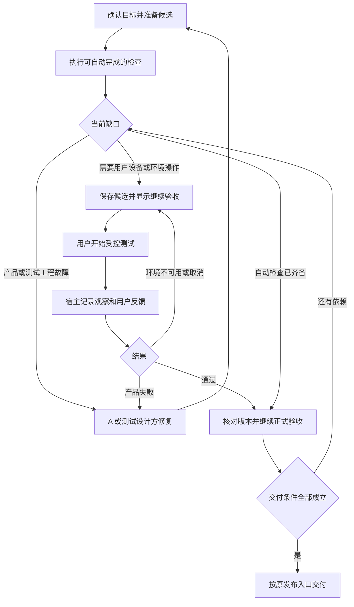

# 用户参与验收的场景与扩展设计

状态：统一入口与设备采集/ASR 首批已实现，并完成实体录音、人工核对及同候选复验。实现与验证边界见 [首批实施记录](assisted-acceptance-implementation-20261114.md)。代码核对设计基线为 8a3a5b5。下文仍包含后续场景的目标设计，不表示所有适配器或成品体验均已验收。

## 1. 要解决的实际问题

当前语伴项目已经执行固定音频、受控 HTTP 和 GUI 用例。缺少实体麦克风证据时，能力检查返回 unverified，制作循环继续安排代码修复。界面没有把该证据缺口变成用户可以完成的动作。核心检查提前返回还可能使独立 B 检查和启动检查没有执行结果。

现有工程可以复用以下能力。

| 当前代码 | 已有能力 | 本次需要补全 |
| --- | --- | --- |
| main/software/verification.ts | 候选、输入指纹、统一正式验收、结果保存 | 结构化前置条件、按依赖执行独立检查、汇总 |
| main/software/trial.ts | 独立试用、数据目录、版本反馈 | 按明确 candidate_id 启动待实测候选 |
| main/software/release-store.ts | 准备候选、校验字节、发布 | 复验有效证据后继续原发布流程 |
| main/software/run-state.ts | waiting_user、waiting_environment、恢复与历史失败 | 关联当前待实测项，恢复原因可判定 |
| main/desktop/capability-verifiers.ts | 按需求选能力验证器 | 返回可执行的缺证据描述与事实来源 |
| main/desktop/speech-verification.ts | 固定音频、可显式调用的设备探针 | 用户入口、进度、设备错误、与产品采集链路分别绑定 |
| main/software/state-view.ts | 运行、验收、交付的只读投影 | 待实测清单、下一动作及实际完成范围 |
| main/ipc/project-deliverables.ts、shared/types.ts | 试用与交付 IPC | 查询、开始、取消、反馈和复验接口 |

现有 launchSoftwareTrial 会根据当前工程准备版本，expectedVersion 主要用于重启时核对旧试用。待实测入口必须扩展为使用明确的已有候选，避免用户点击后实际运行了另一个版本。

## 2. 责任与生成时机

需求阶段确认目标、使用方式和真正改变业务后果的选择。工程细节沿用已有授权和合理默认值。用户可以主动给出体验标准，平台保存到需求范围中。

制作和验收阶段，A 提供实现与开发测试，B 设计独立输入和断言，C/V 按现有流程审阅。宿主根据实际执行结果生成需要人工操作的检查项。

Agent 可以提出检查建议。成为阻塞交付的检查项，必须有已确认需求、既有能力要求或实际缺证据结果的来源。平台内部协议、测试格式、定位器和覆盖修正交回工程处理。

用户点击开始后，执行器负责设备、进程、测试步骤和记录。用户负责必须在实际环境中完成的操作，以及体验判断。执行器观察与用户反馈分别存储，汇总时按对应检查要求使用。

## 3. 场景矩阵

| 场景 | 激活条件 | 用户最小动作 | 平台观察 | 完成范围与失败去向 |
| --- | --- | --- | --- | --- |
| 麦克风采集 | 确认需求需要实体语音输入，候选缺当前设备证据 | 选设备、开始、说一句话、停止 | 权限、帧数、时长、信号、实际产品转写入口、错误 | 设备不可用等环境恢复；产品采集故障进修复 |
| 扬声器和播放 | 确认需求要求可听输出 | 选择输出设备并试听，回答能否听清 | 实际音频资源、播放进度、结束/错误、所播放内容标识 | 播放观察与人工听感分别记录，异常按设备或产品处理 |
| 相机和图像输入 | 需求需要实体拍摄 | 选相机、拍摄一次 | 权限、有效图像、产品处理结果 | 摄像头无帧等环境恢复；图像处理失败进修复 |
| 云模型或外部 API | 需求承诺真实服务效果，受控协议检查已完成 | 在产品设置输入账号/密钥，开始样例调用 | 目标服务、模型、请求状态、用量、结果与输入关联 | 401 等配置问题等用户操作；协议实现故障进修复 |
| OAuth、扫码及登录 | 外部系统要求用户身份操作 | 在官方窗口登录或扫码 | 回调归属、会话建立、受限的业务动作结果 | 等待登录、取消或环境恢复 |
| 跨应用输入/剪贴板 | 需求明确要求写到另一应用 | 选择测试窗口与编辑位置 | 目标窗口身份、写入结果、光标/选择区、前后差异 | 无可用目标等环境恢复；错窗口或丢字进修复 |
| 打印机、蓝牙、串口等外设 | 已确认硬件集成且存在受支持适配器 | 选择设备并做一次实际动作 | 连接、读写回执、设备标识和适配器定义的结果 | 适配器不可用归工程能力缺口，设备不可达归环境 |
| 文件、拖放及权限 | 真实路径或访问权限影响功能 | 选择代表性测试副本或目标目录 | 正常入口操作、输出文件、失败恢复、重开读回 | 无访问权等用户操作；内容损坏进修复 |
| 安装、便携与目标机器 | 承诺安装包/便携分发 | 在目标机器运行指定构建的验证流程 | 包摘要、运行时、安装/启动/卸载结果 | 环境或包问题按实际诊断处理 |
| 局域网、代理、离线 | 确认需求依赖实际网络条件 | 选网络场景，必要时切换连接 | 请求、断网行为、恢复和数据一致性 | 可自动模拟的部分先执行，实际网络证据单独补齐 |
| 性能、长时运行、兼容性 | 需求指定设备、阈值或持续使用条件 | 在指定环境启动已准备的负载 | 计时、资源、错误、环境配置、采样范围 | 阈值由已有承诺或测试计划确定，退化进工程诊断 |
| 角色、视觉、自然度、可用性 | 目标包含体验要求或用户主动评估 | 完成一个真实任务并给具体反馈 | 版本、场景、操作记录、反馈内容 | 明确违背原需求进缺陷；偏好调整进入任务变更 |
| 付款、发送、删除等外部副作用 | 已确认任务包含真实外部写入 | 核对目标、影响和本次操作 | 执行回执、外部状态与幂等标识 | 沙箱优先；无法消除的不确定副作用等核对，恢复时避免重复执行 |

矩阵定义扩展范围。首批实现麦克风和统一框架，其余适配器按真实能力接入。无适配器时给出具体的工程缺口，并继续执行其他独立检查。

## 4. 统一交互

项目交付区提供一个“继续验收”入口。页面按当前候选展示三类内容。

- 已完成的检查和实际观察范围。
- 当前需要用户操作的检查，默认先显示可立即开始的项目。
- 需要工程处理或外部环境恢复的具体事项。

每张待实测卡包含目的、预计操作、设备或服务、数据使用方式、动作按钮和上次结果。版本摘要及报告放在可展开详情中。

麦克风卡的默认操作顺序为选择设备、点击开始、观察输入电平、说话、停止、查看转写。仅设备和权限由平台已有枚举提供选项。开始按钮就表达本次使用设备的意图，浏览器或操作系统权限继续按其机制处理。

提供“稍后测试”“设备不可用”和“报告问题”。稍后测试保存待办，设备不可用保存环境事实，报告问题要求具体观察。普通体验反馈包含“符合要求”“有问题”“暂无法判断”，有问题时展示一句可直接填写的描述。

一次展示最多三项主要待办，其余可以展开。多个检查共享同一次设备会话和一段操作，但每条证据仍绑定各自覆盖的要求。已完成的有效检查直接复用，环境或版本变化再标记需要复测。

## 5. 一条完整生命周期



候选正在等待实测时，已有实际失败继续留在质量记录中。实测通过后，宿主直接调用原正式验收和发布收口；如果出现新的失败再唤醒制作模型。点击按钮、关闭测试窗口和一句“可以了”各自记录对应动作，自动化结果由执行器签发。

## 6. 执行与状态模型

复用项目和运行状态。用户可立即操作时用 waiting_user，外部条件不可用时用 waiting_environment，测试执行期间用 verifying。UI 根据结构化待办投影成“待实测”。普通业务澄清仍按原任务单确认流程。

增加一个受控的验收会话存储。活动会话绑定候选，内部维护检查项及尝试记录。使用原子写入和 revision 检查，界面状态由磁盘记录派生。

```ts
interface AssistedAcceptanceSession {
  version: 1
  id: string
  projectId: string
  operationId: string
  candidateId: string
  scopeHash: string
  rulesHash: string
  revision: number
  checks: AssistedCheck[]
  attempts: AssistedAttempt[]
}

interface AssistedCheck {
  id: string
  adapter: string
  adapterVersion: number
  requirements: string[]
  criterion: string
  required: boolean
  authority: { kind: 'confirmed_requirement' | 'host_capability'; reference: string }
  prerequisites: string[]
}

interface AssistedAttempt {
  id: string
  checkId: string
  idempotencyKey: string
  state: 'running' | 'passed' | 'failed' | 'unavailable' | 'cancelled' | 'interrupted'
  candidateId: string
  rulesHash: string
  environmentDigest: string
  adapterVersion: number
  startedAt: string
  endedAt?: string
  observationRefs: string[]
  userFeedback?: { outcome: 'accepted' | 'issue' | 'unknown'; text?: string }
}
```

stale 是读时根据候选、规则及环境摘要算出的投影。每次尝试保留原结果和时间。用户提供的文件或截图作为用户证据归档，完整自动观察保存在宿主报告中。

检查项的 required 来自目标和宿主能力规则。可选体验反馈不自动升级成新的交付前置条件。取消和缺设备不会改写为产品失败，也不会增加代码修复计数。

## 7. 可扩展接口

使用静态注册的适配器表，由项目已经声明的能力选取实现。

```ts
interface AssistedAcceptanceAdapter {
  id: string
  version: number
  discover(context: CandidateContext): Promise<AssistedCheck[]>
  prepare(context: AttemptContext): Promise<InteractionView>
  execute(context: AttemptContext, signal: AbortSignal): Promise<HostObservations>
  assess(context: AttemptContext, observations: HostObservations): Promise<Assessment>
  close(context: AttemptContext): Promise<void>
}
```

CandidateContext 使用宿主读取的 SoftwareRelease、确认需求、正式报告与环境。AttemptContext 带固定候选、当前尝试身份、租约和专属数据目录。运行器负责幂等、取消、审计和持久化，适配器负责领域步骤与观察解释。

新增适配器只增加其实现、能力匹配及有效性规则。生成项目通过既有声明提供受支持入口，声明经宿主验证后才能运行。公开接口不接收任意命令、脚本路径或自报 passed。

IPC 收敛为四类操作，字段放入现有 shared/types 与 preload 接口。

| 操作 | 入参要点 | 宿主工作 |
| --- | --- | --- |
| query | project_id | 返回当前候选的可读检查视图，执行零副作用 |
| start | project_id、candidate_id、check_id、revision、request_id、用户选择 | 复核候选与依赖，创建或返回同一尝试，启动执行器 |
| cancel | project_id、attempt_id | 终止本次拥有的资源，记录取消 |
| feedback | project_id、candidate_id、attempt_id、revision、反馈 | 绑定本次观察，按适配器规则决定是否齐备，再唤醒宿主复验 |

流程按需通过事件回传 prepared、progress、completed 和具体失败。前端刷新重读当前会话，重发同一个 request_id 返回同一尝试。业务意见需要新需求时仍交给原 scope 流程。

## 8. 证据与有效性

所有自动结果至少绑定 project、operation、candidate、scope、测试规则、适配器版本及环境摘要。环境摘要由适配器选择有意义的字段。

- 麦克风绑定设备、采集实现、ASR 模型资源和使用入口。
- 播放绑定实际音频内容、播放实现、输出设备和播放状态。
- 外部服务绑定地址、模型标识、接口协议、配置 revision 和本次请求身份；密钥仅留在专用存储。
- 跨应用绑定目标进程/窗口身份与实际输入控件，PID 必须结合创建时间或宿主所有权信息核对。
- 安装绑定包摘要、目标环境与执行器身份。
- 体验反馈绑定用户看到的候选和场景，报告注明人工判断范围。

初期以候选级失效为默认。只有适配器显式证明依赖集合完整时，才允许复用未变化组件的证据。当前 speech-verification 的全局组件人工接受记录应归为组件证据，产品按钮与采集链路仍须有项目候选证据。时间窗口由适配器和环境决定，不能单凭尚未超过 24 小时判定所有环境有效。

仅 SHA256 能证明文件对应关系。外部机器报告还需要可信的执行身份或独立复验，随文件附一个散列值不能解决来源可信问题。首期接受已配对宿主执行器的自动报告，用户自行上传的报告标明用户提供。

录音、截图和凭据按实际场景展示使用方式。默认记录完成判断所需的最小信息，原始媒体保存由用户选择。外部调用沿用已授权预算并计入同一账本，测试本身不创建新额度。第三方副作用使用业务幂等键并区分未发送、已发送和结果未知。

## 9. 验收聚合与恢复

在现有 SoftwareVerification 中扩展结构化 obligations。每项记录缺什么、依赖什么、由谁处理和证据来源，减少按错误文案正则决定下一步。

首先检查候选完整性、安全与启动条件。独立的本机 GUI、B 和能力检查按实际依赖执行并分别存结果。某设备缺失时，只阻塞依赖该设备的检查，其余检查仍可继续。安全检查阻断的执行仍保持停止。

聚合优先级如下。

1. 有执行依据的产品失败进入原缺陷修复与复验流程。
2. 测试注册、适配或设计错误进入工程修复，保留原冻结预期和纠正审阅。
3. 只剩用户操作或外部环境依赖时进入待实测，保存固定候选。
4. 全部必需检查通过后继续 C/V、缺陷关闭及发布权威检查。

用户点击后，start 锁定一个候选版本。同一版本同一检查的重复请求合并。制作过程中产生新候选，旧尝试可以停止或完成归档，其结果仅归旧候选。宿主重启把存活情况未知的尝试标为 interrupted，先清理自己的资源，再由用户重新开始设备操作。

原 waiting_environment 恢复逻辑会在源码未变化时直接回显等待。需把“实测证据版本发生变化”纳入恢复判定和 verificationInputs，保证补证后同一源码能重验，历史报告不能被错误复用。

需要用户实测的实例和后续自动验收使用不同数据目录。用户主动修改的数据可按场景导出副本供自动复验，采纳时记录来源与内容摘要。自动清理只处理本次创建且可验证归属的临时资源。

## 10. 多场景异常处理

| 情况 | 处理 |
| --- | --- |
| 同时存在实际缺陷和缺设备 | 优先修可复现缺陷；界面汇总设备待办，避免催用户反复测无效候选 |
| 用户拒绝权限或点击取消 | 保存取消，关闭该尝试资源，允许稍后继续 |
| 用户选择了错误设备 | 重新选择设备生成新尝试，前次事实留存 |
| 权限成功但无输入 | 显示电平和设备选择，按环境处理；有数据而产品未送入识别时按产品问题处理 |
| 网络断开、服务限流 | 展示具体状态与可恢复动作，等待期间不重复扣费调用 |
| 用户只说“可以了” | 有明确待评价的同版本尝试时记录体验判断；缺少实际观察时提示开始对应测试 |
| 成功观察后保存失败 | 尝试未完成，禁止发布；恢复时根据持久日志核对，避免再次产生副作用 |
| 产品新版本或测试预期变化 | 旧结果历史化，重新计算哪些检查有效 |
| 其他用户/会话提交反馈 | 验证操作归属和候选身份，拒绝跨项目写入 |
| 用户自称通过但宿主观察失败 | 展示两种事实并登记待核对问题，自动失败仍要求实测关闭 |
| 体验不满意且自动检查通过 | 针对原承诺登记体验缺陷；新偏好通过原需求变更确认进入下一轮 |
| 暂无任何可运行适配器 | 明确工程能力缺口，并给出已有可用范围；不进入代码无限重试 |

## 11. 首次实施与完成条件

第一批完成统一会话、结构化依赖、固定候选试用、四类 IPC、继续验收界面、取消与恢复，以及麦克风适配器。必须端到端跑“本机检查通过 → 等实体输入 → 用户开始 → 证据保存 → 原候选复验 → 回到发布检查”。

麦克风适配器有两个明确范围。现有 Python 探针验证设备采集和 ASR 入口，产品内按住/松开的采集要通过成品窗口观察。首批必须同时保留两者的范围；运行时缺乏受支持观察方式时如实给出该产品适配缺口。

第二批沿同一接口接入播放、真实云接口和跨应用目标。每项都覆盖成功、失败、取消、重开和重复提交。云接口需要把连接正常、协议正确与实际模型效果分别呈现，避免把一次 HTTP 200 当成体验结论。

第三批接入目标机器执行器、相机和其他外设。安装报告需要可信执行身份，设备扩展需要对应的可观察事实。只有需求激活的检查进入必需清单。

初次实施必须通过以下回归。

1. 仅缺麦克风证据时，制作模型调用不再增加，能独立运行的 B 案例有记录。
2. 有产品故障时仍进入修复，不能靠勾选体验反馈越过失败。
3. 点击开始实际运行目标候选，指定版本错误、候选改动及旧 revision 均被拒绝。
4. 实测成功且证据落盘后，自动恢复正式验收，缺少其余发布条件时仍准确显示剩余项。
5. 取消、拒绝权限、无设备、宿主退出和重复点击均能恢复且不会记成功。
6. 实际采集数据或转写错误能产生失败观察，夹具或模拟源不能伪装成物理设备证据。
7. 场景独立，通过的无关检查保持有效范围，变更相关输入后旧证据失效。
8. 试用反馈绑定旧候选时仍可查阅，不能影响当前候选的发布结论。
9. 用户未要求的可选体验项不阻止交付，新增需求经正常范围确认。
10. 只有发布权威写入完成状态和活动版本，前端提交反馈本身不能更改项目为已交付。

## 12. 当前语伴项目的接入方式

目标项目 9a419eea-12e2-45e3-8c8d-6c3fb20c0012。读取其最新正式候选与报告，检查所有已登记本机结果和未闭合疑点。若当前只有缺少实体采集证据，生成麦克风待实测项并进入等待；如有新的产品失败则先修复。

用户实测使用该候选的实际按住说话入口。宿主保存设备输入和进入 ASR 的证据，后续继续检查语音回复、B 案例及 C/V。当前已有 90 条 GUI 断言的历史记录继续按其版本和虚拟采集范围解释。文档中的设计状态不构成已实现或已交付记录。
