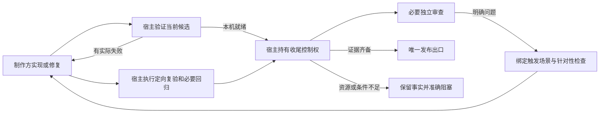

# Bloma 交付收敛实施计划与会话交接

日期：2026-11-09，Asia/Shanghai。**这是下一会话唯一主入口。本文件是待实施计划，不是修复完成声明。** 前批离线机制通过测试，但新一轮真实校园需求仍未交付。本轮只整理方案与交接，不改运行代码，不启动模型请求。

## 1 目标、授权与不可越过的边界

用户最新要求：“给出完整的实施计划，准备会话交接”。下一会话按本计划推进交付收敛工程：让既有 software-v1 从稳定候选进入有界的审查、问题复验和发布；减少重复判断、重复材料和制作 Agent 必须自行串联的内部协议。

- 保留真实执行、独立审查、完整冻结测试、当前版本绑定、原失败和缺陷关闭约束。不得以降低门槛提高交付率。
- 复用原制作者、完整 Pi 伙伴、C/V、quality ledger、验证回执、发布指针和费用账本。不增加常驻管理 Agent、第二份业务断言、平行交付状态机或另一套 PASS 台账。
- 只维护当前 Codex 仓库；不改 Proma、旧源码副本、SYNC-MANIFEST.json 或持久记忆。不要重开旧游戏、涂鸦/静音、FX、UI 重设计任务。
- 用户曾明确恢复真实测试并授权**新一轮独立15元**，不是把旧30元余额转入新轮。目前新轮已因完整输入预留不足而暂停。**这次计划/交接不构成追加金额或恢复付费授权。** 不清 unknown，不重置累计请求，不修改历史拒绝/失败，不借旧窗口额度。
- 工程实现先离线；必要验证通过后分批 commit，不 push。沿用当前 checkout，无需新聊天或新工作树。
- 保护用户未提交文件 `production-workflow-v2-20261020.md`；hash-object 为 `53c7abb3aef8497d8b0522b8aab806c82b2ec164`，不得纳入工程提交。
- 不直接修改真实生成产品或冻结测试来让本轮通过。允许在明确的临时副本中复现、故障注入和验证宿主机制；副本结果不能改写原项目结论。
- 本计划不更换模型/思考档，不默认开启 B，不引入外部模拟用户模型；后续付费方法改变须明确记录并获得相应授权。

## 2 当前基线与两个试验必须分开

| 对象 | 接手核对值 |
| --- | --- |
| 仓库 | `C:/Users/17359/OneDrive/Desktop/guide-agent-platform-sprint0`，分支 `sprint2` |
| 本计划前 HEAD | `db51a5b1ea52b9ac3595c93f7e8c273ac8f477b1`；运行代码基线 `f64faeb`，后续 HEAD 以 Git 为准 |
| 新15元试验根 | `C:/Users/17359/.bloma-validation/campus-from-scratch-20261109-15rmb` |
| 新项目 | `6fbb5c8f-d81f-4103-98cf-9c11cf85c20e` |
| 制作会话 | `observation-3025402b-febb-4daf-90ca-b1436ef2c8cb` |
| 工程伙伴会话 / 委派 | `f1477326-8194-484b-a6c9-db42a1c9f14a` / `cddee738-8f9c-4e61-a357-81d175586bf9` |
| 新项目权威状态 | active / generating_mvp / desktop-implement，`software_release_id` 为空 |
| 当前阻塞 | `QUALITY_FINDING_REPRODUCTION_REQUIRED`；两项 high/suspected 尚无检查记录 |
| C / V | C 执行完成并提出疑点；没有完成 V，不存在正式发布 |
| 新轮测试修正 | 1 项 approved/applied，不等于产品通过 |
| 暂停 | 新根 `pause-generation` 存在；无继续付费的授权 |
| 旧30元试验 | `monitor-campus-client-20261108-30rmb`，项目 `1cead372-7d50-4949-8d1b-50d3f3d0463d`；8 rejected、1 pending，仍单独暂停 |

新项目产品根为新试验根下 `home/agent-workspaces/default-software-builder/generated-projects/<项目ID>`。它不是平台仓库。上述分支、进程、状态均需接手时重读。

### 金额与请求快照

新轮共195条逻辑请求记录，其中193次实际发送；最后两条在发送前被拒绝。192 reported、1 unknown，未知请求为第145条伙伴请求，在第一段超时时取消且没有 usage。

| 角色 | 实际发送 | 已报告计价（元） |
| --- | ---: | ---: |
| 制作负责人 | 79 | 2.846443 |
| 伙伴/调研 | 88 | 5.380749 |
| 代码审查 | 23 | 1.447916 |
| 需求、草图、测试修正裁定 | 3 | 0.994602 |
| 合计 | 193 | 10.669710 |

- unknown 责任预留：2.228224元；责任上界12.897934元；剩余2.102066元。
- 本轮冻结费率下，完整输入加最低2048输出的预留为2.113536元。因此正余额不代表下一次请求可准入。
- 钱包从32.69降至22.14元，差额10.55元；这是账户变化，不替代逐请求账单，也不能用来冲销 unknown。
- 新账本 SHA256：`af4425934b3ae31c8bb3b48705e8a2382b67b86c0d403de3c61ae73be57ea444`。
- 新纠正状态文件 SHA256：`9e84aa628b5b2f67723795a503bbcedf48f7c11ab440dc9fa050e13368ad9586`。
- 旧30元账本 SHA256：`33916f5fff08bc40ce0bdcf3bf2c7869969a9fae21c93e5a93183e9d3ba9e599`；旧账、旧 unknown 与原暂停标记未清理。

这些都是本次读取快照，不是新付费的价格/余额证明。恢复付费前仍须实时核对渠道、模型、费率、余额、epoch、全部责任和完整输入预留；不得手改策略及 manifest 哈希来绕过授权检查。

## 3 真实运行说明了什么

时间均为北京时间，来源是新试验的请求、工具和报告原件。

1. 需求和新草图生成后，浏览器工具拦截本地预览。用户直接确认“确认草图，开始制作”；`ux-confirmation-provenance.json` 明确不是 Codex 视觉确认。
2. 第一轮检查命中动态 HTML 写入和固定凭据规则。修复后进入实际 GUI 检查；活动校验、导入与导出相关检查失败。
3. 提案 `50796811-1e4d-4b3d-88b4-c75f8b85268d` 把 BOM 检查改为原始字节，并补齐成员管理页导航；独立裁定后于15:44:47应用。没有外部代改产品/冻结预期。
4. 第96、111条检查仍因正常启动可见窗口判定未通过而 unverified；不能把较早 GUI 子项通过当成整体通过。
5. 第121条在15:51:58首次完整本机通过。此后至45分钟边界，又有24次实际发送。第124/128条输入可见通过回执之后的伙伴交接，制作方继续修改文档和调查。
6. 第一制作段15:10:57–15:55:59，因外层45分钟时限中断，形成1条 unknown。模型曾写“交付完成”，但宿主没有发布；此自述不能作为结果。
7. 同项目、同账本接续段16:03:31–16:29:19。C于约16:04开始，23次请求后在16:24:49提交5个疑点，历时约20分钟。
8. C之后制作方实际调用4次 edit_file、2次 inspect_app、4次 read_file、3次 run_command、1次 verify_app；第190条登记检查再次通过。但两条 high finding 的 `checks` 仍为0，最后因费用准入停止，结果 incomplete。

### 两个当前高优先级疑点

| finding | 场景 | 当前证据状态 |
| --- | --- | --- |
| `7e72fc6f-b113-469b-a865-0b6c8004fa2e` / F-003 | 管理员进入管理视图，退出后同窗口登录成员；可能残留管理 view | suspected，checks为空 |
| `ee4f02d4-0b39-4cef-9c95-0c743d1fc74e` / F-009，关联F-010 | 成员A查看记录/通知后退出，再登录B；可能残留A的数据 | suspected，checks为空 |

原测试登录助手每次 `page.reload()`，避开了上述真实旅程。另有三个 medium/suspected：月份请求乱序、多个独立客户端进程共用持久登录存储、首客户端退出导致复用其服务端的其它客户端断联。均不能仅凭静态阅读改称实机确认。

### 独立人工观察的边界

`operator-preview/launch.json` 的未发布候选为 `038798d509c8ce0cc4a32dcd826590ba14b9c6141a0563a5f0e9d5113a512f77`，source=`cd3964594d201e9c006b09efad72819661de4adcee5565295272913418d6d6ac`。C原审阅 source=`ce3470f6b99fc9831a021fcc048277cc58df727e095e17ddc12a3932bf835982`，两个版本不能混用。

Codex在独立数据目录实际观察到：管理员登录/统计；不刷新窗口退出并登录成员后回到日历且无管理入口；成员原有记录；报名“秋日校园采风”后0/20变1/20、剩余19；通知从2变3并出现对应报名提醒。该观察支持当前候选的部分修复效果，但未回填正式关闭证据。

成员A→B完整隔离、独立多窗口完整流程、导出实存文件、完整关停重开仍未由本轮人工检查完成。窗口最小化/焦点变化中止了后续操作；部分截图捕获到了其它前台窗口，不能用作产品视觉证据。不要把可访问性树与错误截图拼成通过结论。

operator窗口/进程可能仍存在。接手须重新枚举窗口；进程身份核对可执行文件及最新 `reopened_at`，不使用旧PID/窗口索引。PowerShell ConvertFrom-Json可能已将时间解析为DateTime，不应再按本地字符串重复Parse而错移8小时。

## 4 根因：已核对与待量化分开

| 问题 | 已核对事实 | 判断边界 |
| --- | --- | --- |
| 收尾优先级 | lean-production的beforeComplete/afterTools先partner.take，有建议即返回；partner.suspend在advanceCloseout内部才执行 | 可选建议存在推迟收尾的确定路径；本轮确有通过后收到建议。不能把全部24次请求都判为无效 |
| 完成定义缺少早期可执行覆盖 | 14项登记检查可以通过，但登录助手reload掩盖角色切换旅程；真正多窗口机制未被原F-001直接执行 | 原需求一直存在，不是C临时扩需求；覆盖核对过晚 |
| 新疑点关闭缺绑定 | settleObservedQuality对没有checks/retest的finding不能自动结算；C的新疑点无相应案例绑定 | 已有绑定的自动结算能工作，新发现到可执行证据之间存在断层；不能归咎制作方没调用隐藏记账工具 |
| 通用动作代替具体义务 | quality-closeout对疑点主要路由inspect_app或再次review；反馈要求实际观察，但未持续持有一个可结算的针对性工作项 | 本轮修改/观察/普通复验后checks仍空；进一步循环的全部因果须回放验证 |
| 伙伴去重粒度 | 现在按全局源码、工具参数和结果字节去重；不同grep、偏移、动态输出仍可唤醒 | 保留完整Pi的设计没有问题，付费唤醒与真实阻塞变化未充分对齐 |
| 资源未向完成倾斜 | 一个账本和请求优先队列保证不超支；没有为剩余必需闭环保护资源的统一准入策略 | 伙伴已报告费用占约一半；它对BOM有贡献，不能把全部调用称为无用 |
| 截止时间 | 外层45分钟硬取消与共享执行窗口相关，实际中断在途伙伴产生unknown | 保留硬上限；应提前停止可选工作、排空并保留恢复点，而非延长超时掩盖问题 |
| 验证指标 | 离线可证明机制和反例，不能证明供应商模型会高效结束调查并关闭新问题 | 401项离线全绿不能当作真实生成可靠性或当前校园交付证明 |

另需在回放中量化：C对相同内容的重复读取、历史设计与当前产品的材料混淆、缓存命中、重复计算身份的成本。C的source_manifest中有三份同哈希113390字节草图路径；这证明材料存在别名重复，不证明C实际重复读了三遍。

## 5 目标结构与职责



- **制作方**负责产品代码、必要的测试实现和工程取舍；不负责签发通过、不手工关闭finding、不掌握另一套收尾协议。
- **C/V**负责独立判断和覆盖/绑定确认；C发现不确定性时写清触发、预期、未知与所需观察，不用静态怀疑冒充实测失败。V继续要求当前真实图像。
- **宿主**持有当前候选、必要工作顺序、执行、版本/证据绑定、缺陷结算与发布。可选建议作为材料，不自动夺回制作控制权。
- **伙伴**仍是完整Pi、原child_session_id、笔记和自主工具；按有依据的需求介入。无新事实时等待，进入收尾后不再新开付费调查。在途响应允许沿原invocation结算，不为“安静”强杀制造unknown。
- **费用与期限**仍由既有守卫统一管理；阶段规划只能更保守，不能另发额度或把规划量混入已花/unknown。

收敛约束：每一轮应关闭已知阻塞、补齐明确需要的独立判断/证据，或报告具体不可继续原因。文件改动、重复读、重写说明、再次通过旧案例本身不算关闭进展。真实新问题必须保留，不能为了减少轮次而丢弃。

## 6 实施批次（按依赖顺序，分别验证和提交）

### P0 固化反例和测量基线

- 从新轮原件提取只读回放夹具：第121条通过、第124/128条伙伴交接、超时第145条、C第168条、之后的编辑/观察/复验，以及最后两条未发送拒绝。
- 提取公开输入/工具回执、候选摘要和费用状态；不复制API密钥、隐藏推理、整份用户配置。不能靠导入旧PASS直接让回放成功。
- 增补受控真实Pi测试：验证通过同时伙伴连续给建议；新高疑点无案例绑定；修改后只重跑旧套件；在途请求遇软/硬期限；跨进程恢复。
- 在现有运行遥测中导出：首次就绪到首次C/V/发布的步骤、时间、实际请求和费用；新增/关闭问题；每次返回制作的理由；可选角色重复调查；外部干预；实际/未知用量。不要新增在线进度账本。
- 保留旧实现失败结果，再改代码。退出：至少重现优先级路径和checks为空路径，数据能区分真实新阻断与普通建议。

落点：`tests/unit/software/quality-review.test.ts`、`engineering-partner.test.ts`、`quality-closeout.test.ts`、`quality-settlement.test.ts`、`tests/unit/agent/work-progress.test.ts`；复用runtime-observation、harness-evaluation与trial recorder。

### P1 宿主优先接管稳定候选收尾

- 合并beforeComplete、afterTools、恢复入口的判定顺序：先检查已验证当前候选、原阻塞和必要工作，再分发可选建议；避免多个入口各自解释“完成”。
- 复用advanceCloseout为唯一协调点及原project assignment/执行租约。不要新增closeout-state.json。持有的控制权必须绑定project、operation、invocation与候选Identity。
- 当前候选本机通过后立即停止伙伴的新付费唤醒；已排队但尚未发送的可选请求在取得队列位置后仍须复核资格，不能因早已入队而继续花费。已物理发送的工作沿原invocation排空，不混同强杀。普通建议送入下一次必要审查的参考材料，不自动买一个制作轮次。
- 含新实际失败/重要未知的建议交给既有独立判断和问题队列处理；不按文字关键词自动改成高危finding，也不一概忽略伙伴。
- 源码/规则/目标变化后使旧候选失效，返回明确的必要工作；README、未请求优化等不得在“已就绪”后无任务驱动地扩张。
- 退出：持续普通建议不能饿死C/V；没有新阻塞时不得再次调用制作模型；实际新失败仍阻断；旧invocation收尾不能覆盖新运行。

落点：`main/desktop/lean-production.ts`、`main/software/engineering-partner.ts`、`quality-closeout.ts`、`delivery-qualification.ts`、`main/agent/loop/pi-runtime.ts`及既有委派生命周期。先修控制顺序，不先拆一批同义管理类。

### P2 将新疑点接成可执行、可自动结算的闭环

- 在原quality ledger中区分**已有可靠案例绑定**和**尚缺针对性检查**，由现有finding/retest/checks推导，不再持久化同义状态。
- 对无绑定的重要疑点，宿主保持一个明确的调查义务：触发前提、连续操作、原预期、禁止的遮蔽性前置（如不应reload）、当前版本及缺少哪种证据。制作方只补测试/修复代码，仍使用现有文件工具、inspect_app和verify_app。
- 复用现有独立审查的resolutions/case_name及完整测试候选机制确认绑定。不得按F编号、案例名相似、制作方自称覆盖自动关联。检查旧case的真实触发是否匹配，新增案例也要保持原断言。
- 独立确认绑定后，由宿主直接执行目标检查和必要回归，调用原settleObservedQuality结算；执行成功、测试通过、原疑点被排除/原缺陷关闭必须分开。现有resolutions.case_name已经能写入retest，不另造绑定账本；先打通调度与结算缺口。
- 保留独立审查纠正静态误读/不适用判断的能力，避免所有猜测都变成无限实测义务；但必须给出当前版本的具体依据及范围。对已确认失败、或像本轮两项明确依赖运行时触发的疑点，不能仅写“代码已改”或“旧套件通过”就用reviewed字段绕过实执行。证据类型/来源由受信的既有审查与执行记录确认，不用文本关键词猜测，不自动把旧无类型记录升级为运行通过。
- 临时inspect_app证据可作为调查材料，但未经场景/预期核对不能直接升级成正式PASS。若需要登记为正式案例，宿主明确指出这一项缺口，而非反复返回笼统“再观察”。
- 有已确认失败基线时仍要求同契约复验；新怀疑被排除用not_reproduced，不能伪造曾经confirmed。一次通过旧套件不得关闭新场景。
- 修改后的评审优先使用现有reviewChangeContext和source_manifest核对变更及影响范围；不要每次重做无差别全文审阅，也不能用部分绑定核对冒充完整C。
- 若需区分coverage/binding/candidate审查，使用现有Review记录的宿主来源purpose字段；它不是新的生命周期或PASS账本。旧记录缺字段只读兼容为原candidate语义；非candidate记录永远不能满足最终C/V。
- 不随意放宽sameIdentity/sameQualityScope。现有environment包含rules的耦合必须通过反例核对；需要拆分时另做显式版本兼容子批次，不能让历史PASS误匹配新输入。
- 退出：重放本轮F-003/F-009，经过真实针对性执行后可合法确认、关闭或排除；其它14项全绿但目标未测时保持阻断，并准确给出缺少的动作。制作Agent不需要额外调用内部记账接口。

落点：`quality-review.ts`、`quality-closeout.ts`、`quality-settlement.ts`、`quality-ledger.ts`、`quality-findings-tool.ts`、`native-gui-registration.ts`、`test-corrections.ts`、`verification.ts`、`verification-report.ts`。

### P3 将关键旅程的覆盖核对前移

- 复用已确认需求和冻结原生测试，建立派生的“需求引用→真实操作场景→已有案例/未覆盖项”阅读投影；不保存第二份断言或业务DSL。
- 在首个可运行纵向切片、完整大规模实现前，由现有C能力进行一次范围明确的覆盖核对；不新增常驻角色，不默认启用B。只核对关键旅程与测试是否一致，不签发产品通过。
- 本轮反例必须包含：同窗退出/换账号而不reload；通过产品正常入口创建真正的第二窗口；刷新后的账号隔离与数据同步；两个用户争最后名额；关闭服务端再开；实际下载/保存文件。接口返回、两个token和按钮可点击分别保留自己的验证范围。
- 没有足够早期材料时明确unverified，并把缺项交给制作方；不得填假案例或先跑绿才冻结。新增功能与修改预期仍沿原确认/独立纠正边界。
- 将前置条件按宿主purpose集中在既有审查入口：coverage/binding可核对已确认目标与封存测试材料，不以产品先跑绿为条件；candidate仍要求当前候选的正常本机资格。不能为了前移覆盖而全局放宽QUALITY_LOCAL_CHECK_REQUIRED。
- 最终C继续检查实现和新发现，不能把早期coverage记录复用成当前产品C通过。
- 退出：能在交付收尾前发现“每次登录都reload”“同页双token代替真实窗口”“只GET导出接口代替实际保存”的覆盖缺口；合法连续业务流程可表达且无额外用户协议。

落点：`main/project/requirement-contract.ts`、`native-gui-registration.ts`、`native-gui-tests.ts`、`quality-review.ts`、`quality-review-context.ts`、`production-context.ts`。早期核对与最终评审的用途必须由宿主选择，模型不能传字段跳过门禁。

### P4 伙伴与审查只为需要的信息付费

- 完整公开审计照常保留；付费唤醒以明确请求、新失败/重要约束、与当前阻塞有关的新执行事实为依据。普通成功读取、不同偏移、时间戳/PID变化不自动触发新一轮监督。
- 复用当前sequence/seen、失败指纹、finding和版本化工作区。不要另建“有用度账本”。新源码需要刷新事实，但不等于必须购买一次分析。
- 首次本机就绪后伙伴停车；回到制作时只围绕明确未结问题续接同一Pi。禁止把平台已知的版本/完整性/账本事实再次交给伙伴长期调查。
- 审查材料区分当前产品、冻结测试、确认设计和历史证据；同字节多路径保留全部路径/hash身份，正文只提供一次并注明别名，避免历史设计混作当前代码。
- 复用已有重复读裁剪与变更上下文。独立审查可扩大调查，但须有明确缺口；不凭调用数量机械判定完成，也不让无新证据的读取无限占用预算。
- 退出：连续无关/重复事件不新增付费请求；真正新失败及时送达；旧版本探针只作旧版本证据；取消恢复仍保留原会话、笔记和归属。用相同冻结回放比较请求、输入量和有效问题，不把少调用直接当成质量提高。

落点：`engineering-partner.ts`、`engineering-workspace.ts`、`engineering-monitor-record.ts`、`quality-review-context.ts`、`main/agent/loop/work-progress.ts`、`query-queue.ts`。

### P5 为必要收尾保护时间和费用

- 在现有execution window/monetary guard之上做单一准入决策：从原账本读取已报告、在途、unknown和余额；使用同一费用报价函数计算下一项必要工作与可选调查的准入上界，不能另算一套更宽松金额。
- 队列优先级由宿主登记的委派职责和当前必要工作推导，不靠会话名称前缀或模型自报role；C/V和必要绑定裁定不能与普通研究混作同一低优先级。入队、获准发送之间须重新核对取消、版本与资源。
- 可选伙伴/扩展调查只用必需工作保护量以外的空间。保护量由剩余必要C/V、已知问题复验和实际配置推导，不能固定拍一个百分比，也不能承诺任意复杂任务一定能在给定额度内完成。
- 保护量是调度约束，不是已发生费用，不写成新账本条目，不与真实reserved/unknown重复扣除。若连下一项必要工作也无法准入，提前明确报告资源阻塞。
- 不为凑预算偷偷换模型/降低thinking，不按未经验证的token估计放宽完整输入预留。角色输出上界的调整必须有独立验证与公开有效配置，不用过小输出预算强迫虚假结论。
- 复用现有deadline和取消归属：靠近硬期限时停止新可选工作、安排必要收尾/保存恢复点；给在途请求沿原invocation结算的机会。硬截止与真实用户停止仍有效，不无限延长，不靠取消释放未知费用。
- 任务恢复只能继承同项目/目标/源版本/原账本事实，先验证当前候选再决定是否唤醒制作方。不得自动循环重启45分钟窗口来掩盖无进展。
- 退出：模拟不同额度和在途状态，optional不能抢走mandatory的准入空间；取消等待者不释放他人预留；硬取消仍留下unknown；本轮2.102066不足2.113536的拒绝必须保留。

落点：`main/software/execution-limits.ts`、`main/desktop/lean-budget.ts`、`lean-production.ts`、`main/platform/llm/request-budget.ts`、`monetary-budget.ts`、`main/agent/loop/query-queue.ts`、`scripts/software-observation-trial.ts`、`trial-output-cap.ts`。驾驶器负责执行用户授权和观察，不另作产品质量裁决。

### P6 组合验证与交接完成

- 先使用原校园候选/审阅source_manifest的**隔离副本**重放。复现旧触发条件，必要时从已有旧候选定位审阅版本，不覆盖原产品、冻结测试或质量记录。
- 受控真实Pi完整链路必须从普通制作工具进入：本机就绪→有伙伴消息→C发现新场景→制作修复/追加测试→独立绑定→宿主实际执行→必要C/V→原发布出口。另用无缺陷分支证明可以直接收尾，不能只测被拦住。
- 使用真实Electron/浏览器覆盖跨账号、真实多窗口、不同端口/数据目录、刷新、取消、导入导出文件、完整重开；注入UI错实例、残留旧用户数据、迟到响应和保存失败。
- 把同一次执行中获得的覆盖、版本、图像和关闭证据关联起来。测试、截图、用户手测、真实供应商、干净机安装分别报告，不相加重叠次数。
- 运行各批定向测试、类型/构建、docs:check、git diff --check，最后运行标准check:offline及本计划新增闭环组合用例。源码冻结后跑完整验证；若中途改宿主代码，原版本失效失败保留并针对当前版本复验。
- 不仅记录通过数：报告首次就绪后制作请求数、可选请求数、必要检查次数、问题新增/关闭、每次退回理由、金额/时长、人工干预。无新阻塞分支的后续制作调用应为0；普通伙伴建议不应使必要收尾推迟。
- 离线工程完成只能标记“机制已验证”。真实供应商效果需用户另行授权后验证；未跑、失败或未交付均如实保留，不再把大量离线用例表述成真实收敛已经证明。

## 7 必须通过的反例矩阵

| 反例 | 必须保持的结果 |
| --- | --- |
| 本机PASS同时持续产生普通伙伴总结 | 宿主仍进入必要收尾；不买制作模型来反复消化总结 |
| 伙伴提供当前版本的新实际失败 | 纳入独立判断/必要检查，不能为收尾速度忽略 |
| C发现同窗换账号问题，旧套件全绿 | 保持阻断；明确生成/绑定该触发场景，不自动关闭 |
| 仅改代码、仅inspect、仅再跑旧case | 各自只获得对应事实，不能冒充已闭合 |
| 明确场景经独立绑定并真实通过 | 宿主自动排除疑点或关闭原缺陷，制作方不手工记账 |
| 测试修正后发现真实产品失败 | 可批准合法修正，产品仍失败，禁止发布 |
| 降低断言、删案例、换入口遗弃旧case、跳过登录、断言前清遮罩 | 拒绝或保留失败；不能获交付资格 |
| 旧PASS/旧图片/旧探针、错实例、源或规则变化 | 不可用于当前发布；兼容历史读取不等于迁移为成功 |
| 早期覆盖/局部绑定审查status complete | 不满足最终candidate C或V门槛 |
| 可选请求排队后发生本机PASS或取消 | 获队列位置时不再物理发送；不释放别人的位置，不伪造在途usage |
| 可选工作已用去部分资金、必需收尾还未进行 | 原账本内优先保护必要工作，不转移/新增额度 |
| 截止、未知费用、迟到回执、重复恢复 | 不清unknown，不重置累计请求，不重放副作用，旧invocation不能覆盖新状态 |
| 强只读承诺 | 当前没有OS沙箱就不得作此承诺；显式路径拒绝不能宣传成任意代码隔离 |

## 8 测试入口与实现检查顺序

优先扩展现有文件，避免为每个分支造一套新驱动：

- 收尾/结算：`tests/unit/software/quality-review.test.ts`、`quality-closeout.test.ts`、`quality-settlement.test.ts`、`budget-host-completion.test.ts`。
- 原生/修正：`native-gui-tests.test.ts`、`test-corrections.test.ts`、`test-correction-probe.test.ts`、`verification-tool.test.ts`、`repair-evidence-summary.test.ts`。
- 伙伴/恢复：`engineering-partner.test.ts`、`engineering-workspace.test.ts`、`engineering-monitor-recovery.test.ts`、`long-task-recovery.test.ts`，以及`tests/unit/delegation-{continue,restore,fault-injection}.test.ts`。
- 费用/进展：`tests/unit/model-query-queue.test.ts`、`agent/work-progress.test.ts`、`request-budget.test.ts`、`monetary-budget.test.ts`、`software/funded-execution.test.ts`。
- 驾驶器：`observation-trial.test.ts`、`observation-launcher.test.mjs`、`trial-request-recorder.test.ts`。

测试文件名中的组合写法仅是索引说明，执行时使用实际路径。每批通过后提交；所有权/版本/费用反例失败时先修该批，不继续堆上层功能。回滚用对应提交，不手工回滚业务数据、费用或已写入的历史失败。

## 9 验证指标与完成定义

工程层完成须同时满足：P0反例在旧控制路径失败、新路径正确；P1–P5边界有实执行证据；P6真实Pi＋本机组合能到唯一发布出口；故障分支准确阻断；必要类型、构建、文档和回归通过；无未经授权的状态/费用修改。

真实效果评估须固定任务、模型/思考、总额度和输入版本，单列角色请求、费用、重复读及干预。先比较同输入的有/无伙伴或受控事件路径，不能从一次样本推出成功率；也不能偷偷降低模型档位后声称架构降低了成本。

真正产品交付仍要求：当前候选实际验证、必要C/V完成、重要问题依法闭合、有效活动发布，以及 `completed / completed / delivered` 权威状态。独立用户操作另列。单个本机PASS、模型文本“完成”、草图、未发布候选和手动改状态都不算。

## 10 证据导航与接手操作

新根下主要文件：

- `authorization.json`、`manifest.json`、`quote.json`：原15元授权、路由/运行包/费率快照；不是新授权。
- `trace/timeline.md`、`trace/requests/00121.json`、`00124-input.json`、`00128-input.json`、`00145.json`、`00168.json`、`00190.json`、`00194.json`、`00195.json`：通过、伙伴交接、取消、C提交、普通复验和未发送拒绝。
- `campus/user-run-9ce9080b-e449-4daf-bef0-1f8f8fce5066.json`、`campus/user-run-389c8b34-516a-4061-bae5-bbfd1985747d.json`：两个制作段的权威终态。
- `home/software-quality/<项目ID>.json`：C `f41d3bb8-ec86-48ea-b6a2-db3e8006ee98` 与原finding。
- `home/software-test-corrections/<项目ID>/state.json`：完整纠正与裁定证据；不得手改approved/closed。
- `home/software-verification/<项目ID>.json`、`home/software-releases/<项目ID>/`：当前回执和各候选；当前回执为登记检查passed不等于有活动发布。
- `operator-preview/launch.json`及独立data：只作未发布候选的人工观察。启动辅助脚本须核对当前模块和进程归属，不盲跑历史脚本。

接手先执行只读核对，不导入旧env.ps1，不运行prepare/run/interact：

```powershell
git status --short
git log -6 --oneline
git hash-object docs/05_PROJECT_PLAN/production-workflow-v2-20261020.md
$closeoutTrial = 'C:\Users\17359\.bloma-validation\campus-from-scratch-20261109-15rmb'
Get-Content "$closeoutTrial\pause-generation"
Get-Content "$closeoutTrial\campus\project.json"
(Get-Content "$closeoutTrial\monetary-policy.json.state.json" -Raw | ConvertFrom-Json).entries |
  Group-Object status | Select-Object Name,Count
Get-FileHash "$closeoutTrial\monetary-policy.json.state.json"
```

然后按P0→P1→P2→P3→P4→P5→P6推进并在本文件更新各批状态。P0–P2优先，不用重新跑全部历史狗粮代替修复明确反例。任何新增付费重跑都必须另有明确恢复/总额授权并重新预检；新窗口、原15元、旧30元不能混记。

前批参考：[运行时/事务/证据离线修复与复验记录](session-handoff-engineering-repair-20261109.md)、[软件工程基线](../03_ARCHITECTURE/software-engineering-baseline.md)、[观察方法](observation-only-testing-20261105.md)。历史成功游戏与失败校园分别保留，不以任一结论覆盖另一个。

本交接提交只修改计划和入口；未实现P0–P6，未修改产品、冻结预期、质量台账或费用，未发送付费请求。文档验证与提交结果以本次实际工具输出为准。

## 11 本轮实施记录（2026-11-09）

接手 HEAD 25ca096，保护文件 hash-object 53c7abb3aef8497d8b0522b8aab806c82b2ec164。新旧费用账本和测试纠正文件 SHA256 与第2节一致；新轮 pause-generation 保留。无付费请求、未修改真实产品或原台账。

P0 首批：新增 tests/fixtures/delivery-convergence-20261109.json，只读白名单提取第121/124/128/145/168/190/194/195条请求的时序、发送数、用量、工具反馈与原始文件哈希，以及原finding触发/未知/checks。全量输入、配置和隐藏推理未复制。quality-settlement 回放确认旧套件通过不会结算两条无绑定 high 疑点，原 checks 仍为空。quality-settlement / quality-closeout / engineering-partner 定向测试36项通过。该批仅固化证据和结算反例；P0的真实Pi优先级反例、遥测量化及期限/恢复组合仍待完成，不能据此宣布P0全部退出。

P0 优先级反例补充：真实 Pi 执行器、CLI 子进程和正式发布路径，供应商与伙伴建议受控替身；旧实现于 run-artifacts/delivery-convergence-p0-priority-before.log 失败：本机验证后制作请求达到2次而预期1次。测试暂以 it.fails 固化已知失败，P1修复后改为普通正向断言。该反例不代表真实供应商行为或GUI验收。

P1 控制顺序子批次（验证进行中）：beforeComplete / afterTools 优先检查当前回执，advanceCloseout 在等待必要子任务前停车伙伴；普通建议不再先行返回制作方。下一次必要C/V的读取材料保留工程伙伴意见，由独立审查判断，不按关键词造finding。复用既有requestGuard对已停车伙伴的发送拒绝，不增加状态文件、Agent或额度。

旧路径反例 maker=2（失败），修复路径单独运行 maker=1、C=1、delivered且存在活动发布（62.9秒）。运行真实Pi执行器和CLI子进程，模型/伙伴消息受控；不是供应商或Electron业务验证。并发扩大验证的原始失败保留在 run-artifacts/delivery-convergence-p1-regression.log（37通过、7失败）及 delivery-convergence-offline.log（类型/文档/构建通过，189通过、2失败）。失败含30/60/120秒测试超时及60/90秒取消后未交付断言；正在相同源码、原时限下单worker复验，不能先称全绿。

尚未退出的计划范围：P0遥测量化、软硬期限与跨进程组合；P1已排队/在途/迟到重要事实的组合闭环及所有权反例；P2缺绑定调查义务、受信证据类型、定向复验和原校园隔离副本；P3–P6均未实施。本子批次不是P0–P6完成声明。下一批仍先完成P0/P1剩余反例再进入P2；不以文案更具体代替执行/绑定接线。

验证收口：delivery-convergence-serial-retest.log 在相同运行源码和原时限下串行复验9项全部通过（6项quality-review、1项新增优先级、2项verification-tool），用时369.19秒；新增优先级用例43.46秒完成。未调整生产截止、测试超时、取消信号或业务断言。扩大运行中其余用例通过，原9项失败仍保留；不把失败运行改写成一次全绿。标准离线命令本次退出非零，类型/文档/构建已通过，失败项已定向复验通过。
