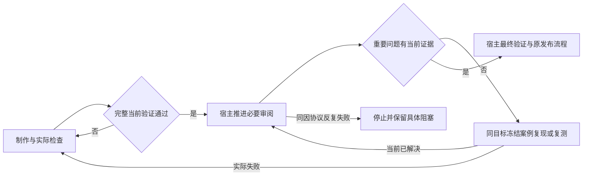

# 软件生成收尾失控：575次请求审计与架构修复

日期：2026-11-04。起点提交`bb19a8d`。本次用户要求停止追加费用、查透重复修复和审阅，并从通用架构解决。调查、回放、实现和验证均离线或连接本机受控服务；没有继续生成涂鸦、没有修改该产品源码或其正式质量台账，没有增加费用。

## 结论与证据口径

575次请求未交付不是正常任务复杂度。主要问题是制作循环、质量台账、正式复验和交付之间只有提示性协调，缺少可执行的收敛规则；同时，协议失败、候选被临时脚本改变以及持续膨胀的恢复上下文放大了循环。

来源为同一项目的usage-ledger、质量台账、事件流和合并金额回执。新增只读脚本`scripts/audit-software-convergence.mjs`只投影计数、状态、身份及用量，不导出提示词、密钥或任意工具文本。冻结统计在`tests/fixtures/convergence-audit-20261104.json`，实际决策字段回放在`tests/fixtures/quality-convergence-replay-20261104.json`；二者是已暴露历史证据，不是独立保留集。

| 观察 | 核对值 | 含义 |
| --- | ---: | --- |
| 物理请求、金额回执 | 575、575 | 一一数量对齐，全部reported；另有4个未发送的逻辑查询，不重复计费 |
| 制作主流程 | 404次 | 不是全部用于写代码，也包含调试、等待、读台账、恢复与收尾 |
| C代码审阅、V界面审阅 | 146次、17次 | 两者共163次，占物理请求约28.3% |
| 需求、草图等 | 3次、5次 | 不能将主要耗费归因于初始需求整理 |
| 审阅记录 | 23次，11完成、12中断 | 中断中10次没有实际子模型传输；不能将它们都称为模型审阅能力失败 |
| 中断逐笔归因 | 输出预算9次、金额准入2次、回合耗尽1次 | 从持久Pi会话的delegation_id对应summaries恢复，不靠整段日志关键词猜测；输出预算问题含父子预留争用，已在先前修复 |
| 审阅候选摘要 | 16个 | 包含产品改动与诊断脚本改动，不能一律理解为16次有效业务修复 |
| 审阅意见 | 59条 | 31 suggestion、9 disputed、19 suspected；并非59个已确认缺陷 |
| suspected细分 | 1 high、4 medium、14 low | high为最后V发现的损坏规则回放不一致；低优先疑点不应自动扩充本轮目标 |
| 正式finding复现工具、台账case checks | 0次、0条 | 独立操作员确实做过复验，但没有沿平台正式finding闭合链执行，不能将独立报告冒充正式关闭 |
| 审阅提交错误 | 8次 | 包含体验concern关联、额外字段、视觉观察与需求ID协议错误 |
| 主流程上下文 | P50 225845，P95 462055，最大475900 token | 404次主流程请求累计缓存输入92125312 token；缓存仍有费用且不解决旧意见干扰 |

另查主制作持久会话：842条message、421条custom，无compaction记录。按本次脚本的紧凑JSON口径，toolResult文本约100.7万字符，其中12次read_quality_findings累计约38.6万字符。该数值是会话存储字符统计，不等于供应商token数或费用。最近一次C只相对前次改变`public/index.html`和`public/styles.css`，仍用了24次模型请求；差异提示已经存在，不能把“提供了差异”当成已经控制了重读成本。

## 根因，不把所有失败混为产品缺陷

| 根因 | 代码或实际证据 | 本次处理 |
| --- | --- | --- |
| 重要疑点随源码改变从当前队列消失 | 原qualityCloseout只筛sameIdentity的suspected；gate只硬挡已有失败check的缺陷。制作方先改代码再审阅，旧疑点既未复现也未关闭 | 同目标/环境的重要疑点跨源码保留；正式gate和新审阅准入使用同一工作队列 |
| “先复现再修”工具对新增测试不友好 | 原check_quality_finding无失败基线时要求与原审阅完全相同源码；新增复现脚本本身也改变摘要 | 未确认疑点可在同目标/环境当前候选执行冻结案例。通过只记当前not_reproduced，保留原审阅身份与current_candidate_only标记；已确认缺陷仍严格同案例同规则复测 |
| 收尾控制权仍留给模型的结束声明 | beforeComplete只在无工具输出时触发。模型可在验证后继续读建议、改非必需项，再使审阅失效 | 增加通用afterTools宿主交接钩子；现役生产仅在完整verify_app或finding复测产生当前请求、当前输入的有效通过凭据后启动收尾。宿主运行所需C/V，门齐后直接交给原验证/发布链 |
| 宿主反馈到达晚一轮 | 初版afterTools使用followUp，受控试验产生3次而不是2次调用 | 工具后反馈走下一轮前的steer；回归验证不再多买中间声明，并防止收尾吞掉途中到达的用户纠正 |
| 同候选有效审阅仍可重复请求 | start_quality_review/start_visual_review可直接创建新审阅 | 同身份、同类、最新完整且体验观察已明确的审阅直接返回already_reviewed；V仍校验图片授权和有效期，不复用过期或取消结果 |
| 临时观察代码与交付代码共用目录 | 真实轨迹存在审阅后增删tests/dev-visual.mjs、dev-ro-shot等，使完整源码摘要变化 | inspect_app新增script_source，沿原隔离运行器执行，正文存宿主会话诊断目录。真实浏览器验证执行有效且候选摘要不变；未按tests目录粗暴排除源码 |
| 历史台账反复作为当前任务输入 | read_quality_findings每次返回全量reviews/findings，包含失效候选和非阻塞建议 | 默认返回当前必修队列、最新审阅和历史索引；finding_id可读取单条完整历史。原始台账不删除 |
| 只读审阅没有同因协议失败停止机制 | 原work-progress仅对implementation启用，C/V可反复提交错误结构直到轮数耗尽 | 通用协议错误守卫覆盖只读角色；同一schema/审阅提交原因连续累计3次未解决即停止，读取文件不算纠正，成功提交才清除对应错误；不把停止标成PASS |
| 本机检查与付费审阅顺序不经济 | 最后修复被免费静态DOM检查挡住，先前已多次支付审阅成本 | 上轮已把相同静态门禁前置于C/V，本次保留。完整本机检查通过后的自动收尾复用现有验证凭据；未放宽安全门或凭图片替代功能检查 |
| 测试组织反复续跑、扩执行上限 | 真正平台缺陷未先形成可回放闭环，就多次恢复同一大历史会话；操作员纠正过503断言误判，也介入过产物回归诊断 | 本轮冻结付费入口，保留旧失败，不迁移会话归属、不改产品或清零额度。先用同一事件口径和受控端到端验证机制，不能再用“多跑一些”代替诊断 |

费用/输出预留等待、浮点金额比较、ID别名及源码差异材料等在此前提交已修复；它们是本次追溯的重要因素，但不是本次新实现。575次累计包含这些历史缺陷和人工调查，不能当作当前版本的稳定成功率样本。

## 当前执行链

只有实际完整通过凭据可以触发工具后的宿主交接；阶段检查、inspect_app、打印PASS和不完整工具结果均不触发。经过C/V后如果有真实缺陷，仍回到复验与修复；建议和争议不会默认进入必修队列。用户在宿主等待审阅期间追加纠正，模型必须先处理，不能自动结束。

没有引入另一套任务库或“所有代码变化都算进展”的完成计数器。质量台账仍是问题事实源，验证凭据仍是运行事实源，原里程碑/发布仍是交付事实源。本次加强它们之间的控制关系，不另建平行通过状态。

## 验证与剩余边界

新增/加强的受控回归覆盖：真实历史决策字段跨版本回放、重要疑点不能被重审覆盖、同候选审阅幂等、当前未复现不冒充原版修复、已确认缺陷同规则失败/通过闭合、主循环无需额外结束声明、途中用户纠正、只读协议重复失败、旧状态投影与历史可读、浏览器临时脚本不改变候选。

验证结果：核心联合7文件71项通过；独立调试运行器7项通过，包含实际浏览器与Electron。随后新增持久会话投影回归，验证原始旧状态仍在native历史、供应商输入只收到当前快照。类型检查、完整构建及文档检查通过。首轮两项失败均已归因：旧V断言期待“先重审”而新顺序要求“先复测”，按新控制语义修订后通过；工具后followUp晚一轮的真实控制缺陷已改为steer并复验，未放宽调用数断言。

端到端受控案例使用实际CLI和浏览器、真实Pi会话/图片协议及本机模型替身，继续检查原发布流程。它们能证明控制流和证据边界；不能证明真实DeepSeek在新架构下会减少到多少次请求。原涂鸦正式交付仍未完成，录像和增量仍未开始，本次没有消除或掩盖这个结果。

尚需验证的不是“把上限再抬高”，而是：同一需求从零到交付的总调用数、非阻塞意见引起的源码改动数、重审次数与原因、重要问题的实际case闭合率、恢复首轮上下文大小、独立功能和体验结果。后续真实试验须在用户重新授权费用后进行；先复跑原样例，再使用队列/媒体等不同结构任务，不能只凭当前样例的单次改善宣称通用能力。

本次不强制按比例缩小模型上下文，不抹掉任意历史文件读写，不按目录忽略测试/产品依赖，不重置长任务会话或计费。开放语义判断、自动覆盖多页面/异常状态、测试案例质量、模型主动忽视差异提示等问题仍需以分层证据评估；新控制流降低的是重复工作的机会，不保证生成内容天然正确。
